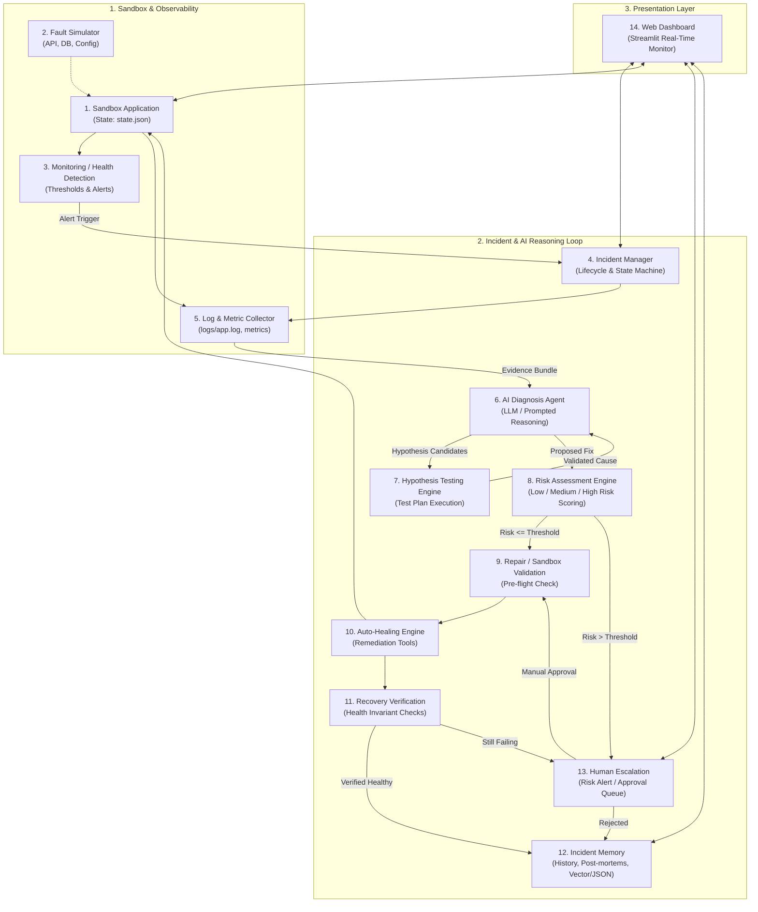
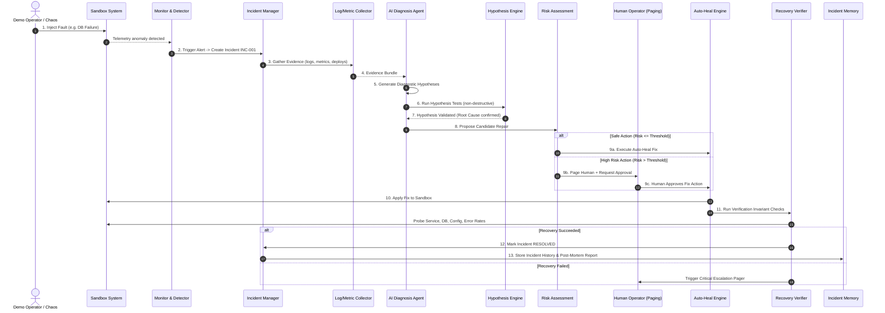

# AutoHeal AI — Architecture Specification

> **Hackathon Prototype**: Autonomous Incident Diagnosis, Hypothesis Testing, Safe Remediation, and Human Escalation.

---

## 1. Overview & Problem Statement

Modern cloud operations require SREs and DevOps teams to triage incidents under high stress. **AutoHeal AI** is an autonomous site reliability agent that:
1. Detects anomalies and failures in a sandbox application.
2. Gathers multi-modal evidence (logs, metrics, deployment history).
3. Formulates diagnosis hypotheses and actively tests them using non-destructive inspection tools.
4. Assesses the operational risk of candidate repairs before taking action.
5. Executes safe automated fixes in the sandbox, or pauses for human-in-the-loop escalation when actions exceed acceptable risk thresholds.
6. Rigorously verifies full recovery and archives the incident post-mortem into incident memory.

---

## 2. Core Architecture: 14 Functional Components



### Detailed Component Roles

1. **Sandbox Application (`sandbox.py` / `state.json`)**
   - Simulates core microservices: API Service, Database Engine, Configuration Provider, and Resource Telemetry (CPU, memory, error rates).
   - Backed by persistent state file (`state.json`) so the dashboard, simulator, and agent share real-time state across distinct processes.

2. **Fault Simulator (`simulator.py`)**
   - Injects controlled chaos scenarios:
     - *API Service Outage* (crashes service, spikes CPU, triggers port connection errors).
     - *Database Connection Failure* (pool exhaustion, timeout, health probe failure).
     - *Invalid Configuration Rollout* (bad schema, misconfigured flags, validation errors).
     - *High Risk / Unknown Cascades* (scenarios requiring human intervention).

3. **Monitoring / Health Detection (`monitor.py`)**
   - Continuously scans metrics and log streams against SRE SLOs (Service Level Objectives).
   - Emits alerts when error rate > 5%, service status is down, or health probes fail.

4. **Incident Manager (`incident_manager.py`)**
   - Tracks the active incident lifecycle: `DETECTED` → `DIAGNOSING` → `TESTING` → `REPAIRING` → `VERIFYING` → `RESOLVED` (or `ESCALATED`).
   - Assigns unique incident IDs (e.g., `INC-1042`), maintains state, and records timeline timestamps.

5. **Log and Metric Collector (`collector.py` / `tools.py`)**
   - Aggregates multi-source evidence:
     - Structured JSON logs from `logs/app.log`.
     - System resource metrics (CPU, Memory, Error Rate).
     - Deployment diffs and recent releases.
     - Service dependency health states.

6. **AI Diagnosis Agent (`agent.py`)**
   - Ingests the evidence bundle.
   - Leverages an LLM (Gemini API with fallback heuristic engine) to synthesize symptoms into candidate root causes.
   - Outputs structured diagnosis outputs with confidence scores and recommended diagnostic tests.

7. **Hypothesis Testing Engine (`tester.py`)**
   - Instead of blindly applying fixes, it formulates non-destructive verification actions:
     - *E.g., Test: ping port 8080 or inspect latest config keys.*
   - Disproves false positives and confirms the true root cause before modifying state.

8. **Risk Assessment Engine (`risk_assessor.py`)**
   - Evaluates the blast radius of candidate repair actions:
     - **Low Risk** (Restart stateless API service, re-read cached config).
     - **Medium Risk** (Safe configuration rollback to previous known-good tag).
     - **High Risk** (Database repair, table re-indexing, destructive restarts).
   - Enforces policy: High-risk actions automatically halt and trigger Human Escalation.

9. **Repair / Sandbox Validation Engine (`validator.py`)**
   - Pre-flight validation ensuring prerequisites are met prior to mutating production/sandbox state.
   - Validates that target services are in an actionable state and rollback snapshots exist.

10. **Auto-Healing Engine (`tools.py` / `executor.py`)**
    - Executes the approved remediation action via tool contracts:
      - `restart_service()`
      - `rollback_config()`
      - `repair_database()`

11. **Recovery Verification (`verifier.py` / `tools.py`)**
    - Runs post-repair smoke tests and invariant checks:
      - Checks `service == "running"`
      - Checks `database == "healthy"`
      - Checks `config == "normal"`
      - Confirms `error_rate < 5%` over stabilization window.

12. **Incident Memory (`memory.py`)**
    - Stores structured incident post-mortems (JSON/Vector store):
      - Incident symptoms, logs, tested hypotheses, chosen remediation, MTTR (mean time to recovery).
    - Enables future diagnosis to recall prior resolved incidents ("Few-shot incident retrieval").

13. **Human Escalation (`notifier.py`)**
    - Escalation router for high-risk actions, failed automated repairs, or low diagnostic confidence.
    - Generates SRE incident briefings, pager alerts, and interactive approval cards on the dashboard.

14. **Web Dashboard (`app.py` - Streamlit)**
    - Real-time SRE control plane:
      - Live system health metrics and architecture status.
      - Interactive fault injector panel for live demos.
      - Real-time reasoning trace (Evidence → Hypothesis → Test → Fix → Verification).
      - Human-in-the-loop approval modal and incident history archive.

---

## 3. End-to-End Workflow (13-Step Lifecycle)



---

## 4. Proposed Clean Folder Structure

To keep the system modular and maintainable while strictly preserving existing code, the proposed structure organizes files cleanly:

```text
autoheal/
│
├── README.md                      # Project overview & demo instructions
├── ARCHITECTURE.md                # System design & component contracts (this document)
├── requirements.txt               # Dependencies (streamlit, google-genai, etc.)
│
├── config/
│   └── settings.py                # Configuration constants, thresholds, risk policies
│
├── core/
│   ├── state.py                   # Persistent shared state manager (state.json)
│   ├── incident.py                # Incident data model & state machine
│   └── memory.py                  # Incident history & post-mortem archive (data/incidents.json)
│
├── sandbox/
│   ├── app_state.py               # Sandbox system simulation logic (preserving sandbox.py)
│   ├── faults.py                  # Fault simulation triggers (service, DB, config)
│   └── monitor.py                 # Health monitoring & threshold alerts
│
├── tools/
│   ├── observability.py           # get_logs, get_metrics, check_db_health
│   ├── remediation.py             # restart_service, rollback_config, repair_database
│   └── verification.py            # verify_recovery
│
├── agent/
│   ├── diagnosis.py               # AI agent reasoning (Gemini API + rule-based fallback)
│   ├── hypothesis.py              # Hypothesis generator & tester
│   ├── risk.py                    # Risk assessment rules & classification
│   └── orchestrator.py            # End-to-end AutoHeal loop orchestrator
│
├── ui/
│   ├── components.py              # Streamlit widgets (metrics, timeline, alert cards)
│   └── styles.py                  # Visual styling
│
├── data/
│   ├── state.json                 # Shared live runtime state
│   ├── incidents.json             # Persisted incident history
│   └── logs/
│       └── app.log                # Structured JSON application logs
│
├── app.py                         # Main Streamlit web application entry point
├── sandbox.py                     # Legacy / standalone CLI sandbox (preserved)
├── tools.py                       # Legacy / standalone tools wrapper (preserved)
└── agent.py                       # Legacy / standalone CLI agent (preserved)
```

> [!TIP]
> **Preservation Strategy**:
> Existing files (`sandbox.py`, `tools.py`, `agent.py`, `app.py`) remain functional at the root level. The modular packages can wrap and build upon them so existing tests or scripts never break.

---

## 5. Hackathon Simplicity Principles

To ensure this prototype can be built, demonstrated, and explained within hackathon constraints:

1. **Shared State via Lightweight JSON**:
   - Instead of heavy external databases (Redis/PostgreSQL), use `data/state.json` with thread/file locking. Both the Streamlit UI and background CLI agent share instant real-time synchronization.

2. **Dual-Mode AI Engine (LLM + Deterministic Fallback)**:
   - Primary: Uses Google Gemini API (via `google-genai` SDK) to parse logs and formulate intelligent reasoning.
   - Fallback: Uses a deterministic rule-based engine if offline or rate-limited, guaranteeing zero-failure live demos.

3. **Explicit Risk Tiers for SREs**:
   - `LOW`: Automatic auto-heal without human interruption (e.g., service restart).
   - `HIGH`: Auto-heal pauses; UI displays a prominent **"Human Approval Required"** card with risk rationale and button actions.

4. **Demo-Friendly Incident Visualizer**:
   - Visual step-by-step progress stepper in Streamlit showing:
     `Detection` ➔ `Hypothesis Testing` ➔ `Risk Analysis` ➔ `Auto-Healing` ➔ `Verification`.
   - Judges can see the agent's exact "internal thoughts" and tool results at each step.
